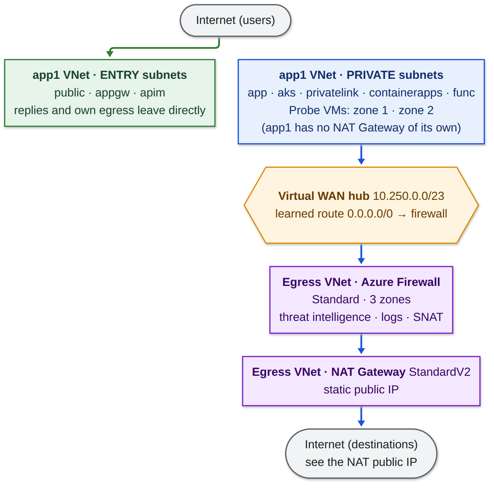

# azure-vwan-firewall-egress

[](https://scorecard.dev/viewer/?uri=github.com/jalcalaroot/azure-vwan-firewall-egress)

Centralized internet egress for application VNets on **Azure Virtual WAN**: every private subnet leaves through one **Azure Firewall** in front of a zone-redundant **NAT Gateway (StandardV2)**, so all spokes share a single, stable outbound IP and one place to inspect, log and control egress traffic. Inbound traffic keeps entering through each VNet's own public subnets. Includes `app1`, an application VNet with the same layers as [`azure-virtual-network`](https://github.com/jalcalaroot/azure-virtual-network) but no NAT Gateway of its own. Standalone Terraform project — own backend, own state.

## Architecture



- **Green:** inbound traffic enters through each VNet's own public subnets (`public`, `appgw`, `apim`), which also keep a direct outbound path for their replies.
- **Blue:** every private subnet leaves through the hub's `0.0.0.0/0` route to the firewall, which performs SNAT through the NAT Gateway. Destinations see a single, stable public IP.

A NAT Gateway cannot sit in a Virtual WAN hub or receive traffic from another VNet, so the egress lives in its own VNet behind the hub ([Azure NAT Gateway FAQ](https://learn.microsoft.com/azure/nat-gateway/faq)). The hub's `rt-spokes` carries the `0.0.0.0/0` route to the firewall, and spokes cannot see each other.

## Resources deployed

| Resource | Purpose | Docs |
|---|---|---|
| Virtual WAN (Standard) + virtual hub | Transit service; `rt-spokes` / `rt-egress` route tables, static `0.0.0.0/0` on the egress connection | [Virtual WAN](https://learn.microsoft.com/azure/virtual-wan/virtual-wan-about), [Hub routing](https://learn.microsoft.com/azure/virtual-wan/about-virtual-hub-routing) |
| Azure Firewall (Standard, 3 zones) + Firewall Policy | SNAT, threat intelligence, DNS proxy, web traffic logged by domain, denied web categories, Policy Analytics | [Azure Firewall](https://learn.microsoft.com/azure/firewall/overview), [Rule processing](https://learn.microsoft.com/azure/firewall/rule-processing) |
| NAT Gateway (StandardV2) + public IP | The single, stable outbound IP for every spoke | [NAT Gateway](https://learn.microsoft.com/azure/nat-gateway/nat-overview) |
| `vnet-egress` | Holds `AzureFirewallSubnet` only | [VNet overview](https://learn.microsoft.com/azure/virtual-network/virtual-networks-overview) |
| `app1` VNet + 10 subnets | Application VNet, no own NAT; built on [`Azure/avm-res-network-virtualnetwork` v0.22.2](https://registry.terraform.io/modules/Azure/avm-res-network-virtualnetwork/azurerm/0.22.2) | [Default outbound access](https://learn.microsoft.com/azure/virtual-network/ip-services/default-outbound-access) |
| NSGs, route tables, ASGs (`app1`) | Per-subnet rules with explicit outbound allow; entry subnets keep direct internet | [NSG overview](https://learn.microsoft.com/azure/virtual-network/network-security-groups-overview) |
| Log Analytics Workspace | Firewall resource-specific logs (`AZFW*` tables), NSG diagnostics and Traffic Analytics | [Firewall logs](https://learn.microsoft.com/azure/firewall/monitor-firewall) |
| VNet flow logs (`app1`, `vnet-egress`) + dedicated storage account | Per-VNet and per-subnet traffic history, including flows that never reach the firewall; Traffic Analytics on top | [VNet flow logs](https://learn.microsoft.com/azure/network-watcher/vnet-flow-logs-overview) |
| Diagnostic settings (10 `app1` NSGs) | NSG events and rule counters in Log Analytics | [NSG diagnostic logs](https://learn.microsoft.com/azure/virtual-network/virtual-network-nsg-manage-log) |
| 2 Linux VMs (`app1`, zones 1 and 2) | Probe instances in `snet-app`, no public IP, used to verify the egress from each zone | [Availability zones](https://learn.microsoft.com/azure/reliability/availability-zones-overview) |

## Egress policy

| Order | Rule | Effect |
|---|---|---|
| First | Threat intelligence (`Deny`) | Blocks traffic to and from known malicious IPs, domains and URLs |
| 100 | `deny-rfc1918` | Spokes only reach the internet, never private ranges through the firewall |
| 200 | Network allow | Every port and protocol except web (TCP 80/443) and QUIC (UDP 443) |
| 250 | `deny-categories` | Denies the configured web categories |
| 300 | `allow-all-web` | Allows HTTP/HTTPS and logs every domain in `AZFWApplicationRule` |

Network rules are evaluated before application rules, which is why web traffic is excluded from the network allow. Details in [docs/firewall.md](docs/firewall.md).

## Prerequisites

- [Terraform](https://developer.hashicorp.com/terraform/downloads) >= 1.5.0
- [Azure CLI](https://learn.microsoft.com/cli/azure/install-azure-cli), logged in via `az login` with Contributor-or-better on the subscription
- An existing resource group (`jalcalaroot` by default) and the shared tfstate storage account
- A region that supports NAT Gateway StandardV2 (`eastus` by default)

## Usage

```bash
az login
export TF_VAR_subscription_id="<subscription-id>"

terraform init
terraform apply        # the hub takes ~35 minutes
```

Verify the egress from both zones; each probe VM must return the NAT Gateway IP (`terraform output egress_public_ip`):

```bash
for z in 1 2; do
  az vm run-command invoke -g <resource-group> -n vm-app1-probe-z$z --command-id RunShellScript \
    --scripts "curl -s --max-time 15 https://ifconfig.me" --query "value[0].message" -o tsv
done
```

To connect another application VNet, use [`modules/spoke-connection`](modules/spoke-connection) and follow the [spoke contract](docs/spoke-contract.md).

## Configuration

| Variable | Default | Notes |
|---|---|---|
| `subscription_id` | — | via `TF_VAR_subscription_id` |
| `resource_group_name` / `location` | `jalcalaroot` / `eastus` | |
| `hub_address_prefix` | `10.250.0.0/23` | |
| `egress_vnet_address_space` / `egress_firewall_subnet_cidr` | `10.251.0.0/24` / `10.251.0.0/26` | |
| `vnet_address_space` and `*_subnet_cidr` | `10.1.0.0/16` and the `10.1.x.x` layout | `app1`; address spaces must not overlap |
| `spoke_address_space` | `10.0.0.0/13` | Source range the firewall rules accept |
| `block_private_destinations` | `true` | Firewall denies RFC1918 destinations |
| `denied_web_categories` | `ChildAbuseImages`, `CriminalActivity`, `IllegalSoftware` | Web categories the firewall denies (FQDN-based on Standard) |
| `app1_dns_via_firewall` | `false` | Use the firewall as DNS; effective only when set at VNet creation |
| `probe_vm_size` / `probe_vm_zones` | `Standard_D2as_v4` / `["1","2"]` | |
| `log_analytics_retention_days` | `30` | |
| `flow_log_retention_days` | `30` | Retention of the VNet flow logs in storage |
| `flow_logs_storage_account_name` | `stflowvwanjalcalaroot` | Globally unique |
| `enable_traffic_analytics` | `true` | Set to `false` if flow log creation fails with `TAUserDoesNotHavePermissions` (known provider issue, see `variables.tf`) |

## Outputs

| Output | Description |
|---|---|
| `virtual_hub_id`, `route_table_spokes_id`, `route_table_egress_id` | What a spoke needs to connect |
| `egress_public_ip` | Outbound public IP of every spoke |
| `firewall_private_ip` | Next hop of the `0.0.0.0/0` route |
| `app1_vnet_id`, `probe_vm_names` | `app1` VNet and its probe VMs |

## Validation

Deployed and verified twice against a live subscription. The probe VMs in two zones reach the internet through the firewall and the NAT Gateway with the same public IP; the firewall rules, threat intelligence, web categories and DNS proxy behave as designed, and every decision is visible in the firewall logs. Results in [docs/validation.md](docs/validation.md).

## Documentation

| Document | Content |
|---|---|
| [docs/design.md](docs/design.md) | Requirement, design constraint, routing model, high availability, cost |
| [docs/firewall.md](docs/firewall.md) | Rules, behavior, alignment with Microsoft recommendations, DNS proxy |
| [docs/spoke-contract.md](docs/spoke-contract.md) | What an application VNet must do to use the egress |
| [docs/validation.md](docs/validation.md) | Deployment and verification results |

## Security

Secret scanning with [gitleaks](.github/workflows/gitleaks.yml) on every pull request and push, dependency updates with Dependabot, and [OpenSSF Scorecard](.github/workflows/scorecard.yml). See [SECURITY.md](SECURITY.md).

## Cost

About US$1.7 per hour (~US$40 per day) while deployed, ~70% of it the firewall. The stack is created on demand; the hub takes ~35 minutes. Breakdown in [docs/design.md](docs/design.md#cost).
