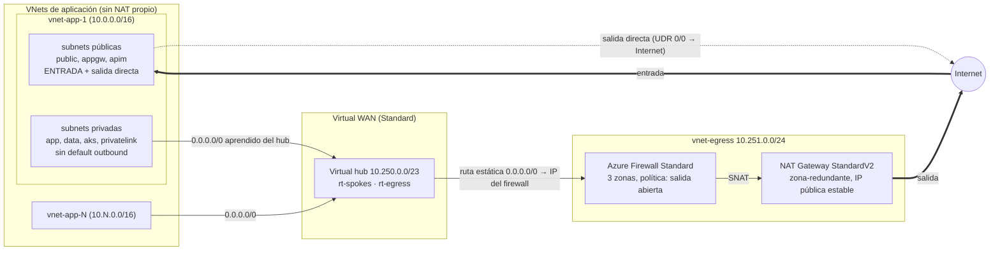

# Diseño: salida centralizada a internet con Virtual WAN

## Requisito

Las VNets de aplicación (estructura de `azure-virtual-network`) no tienen NAT propio: **toda la salida a internet pasa por un punto central de alta disponibilidad** con IPs de salida estables. La **entrada** sigue llegando por las subnets públicas de cada VNet.

## Restricción que condiciona el diseño

El NAT Gateway **no está soportado en el hub de Virtual WAN**, ni en la `AzureFirewallSubnet` de un secured hub (Microsoft lo documenta en *Scale SNAT ports with Azure NAT Gateway*, *Secure your Azure Firewall deployment* y *Troubleshoot NAT gateway*). Un NAT Gateway solo puede asociarse a subnets de una VNet normal conectada al hub.

Por eso la salida vive en una **VNet de egress** conectada al hub:

| Opción | NAT Gateway | Gestión del firewall | Elegida |
|---|---|---|---|
| A. Secured hub (Azure Firewall en el hub + routing intent) | **No** (solo IPs públicas del firewall, hasta 80) | Microsoft, rutas automáticas | No |
| **B. VNet de egress: Azure Firewall + NAT Gateway StandardV2, 0.0.0.0/0 estático en la conexión** | **Sí** | Nosotros (rutas explícitas) | **Sí** |
| C. Hub-and-spoke clásico con peering (sin vWAN) | Sí | Nosotros | No (se pidió vWAN) |

La opción A es más simple de operar pero no cumple "NAT". Si más adelante se prefiere simplicidad sobre IPs estables y 64.512 puertos SNAT por IP, se puede migrar a A.

## Arquitectura

## Enrutamiento (sin routing intent)

Dos tablas de rutas personalizadas en el hub:

| Tabla | La usan (asociadas) | Contiene | Efecto |
|---|---|---|---|
| `rt-spokes` | todos los spokes | `0.0.0.0/0 → firewall` (estática, publicada por la conexión de egress) + prefijo de la VNet de egress | Los spokes salen por el firewall y **no ven a otros spokes** |
| `rt-egress` | la conexión de egress | prefijos de todos los spokes (propagados) | El firewall sabe devolver las respuestas |

Detalles de configuración que Microsoft exige y que ya están en el código:

- La conexión de egress tiene `internet_security_enabled = false` (la conexión que anuncia el 0/0 no debe recibirlo: evita bucles).
- Las conexiones de los spokes tienen `internet_security_enabled = true` (es lo que hace que aprendan el 0/0).
- El 0/0 estático **no se propaga entre hubs**: cada hub/región necesita su propia VNet de egress.
- Los 0/0 en la conexión de egress apuntan a la IP privada del firewall, no a la IP del router del hub.

El firewall además **niega destinos RFC1918** (variable `block_private_destinations`): defensa en profundidad sobre el aislamiento por rutas. Se desactiva cuando haya conectividad híbrida que deba pasar por él.

## Alta disponibilidad

| Componente | Cómo es HA |
|---|---|
| Virtual hub / router | Gestionado por Microsoft |
| Azure Firewall | 3 zonas de disponibilidad |
| NAT Gateway | StandardV2: zona-redundante por diseño (sin `zones`) con IP pública StandardV2 |

No cubre la caída de una región completa (un solo hub). Para DR habría que repetir hub + egress en una segunda región.

## Qué NO hace este repo

- No crea las VNets de aplicación; las conectan ellas con `modules/spoke-connection` (ver `spoke-contract.md`).
- No define DNS privado centralizado (las zonas `privatelink.*` siguen vinculadas por VNet).
- No filtra por FQDN (salida abierta por decisión del propietario; se puede endurecer añadiendo reglas de aplicación antes de la regla `allow-all-outbound`).
- No incluye CI ni identidades de CI todavía (ver pendientes en `CLAUDE.md`).

## Costo (orden de magnitud, precios de lista aproximados: verificar en la calculadora de precios)

Mientras esté desplegado, sin tráfico: hub Standard (~US$0,25/h) + Azure Firewall Standard (~US$1,25/h) + NAT Gateway y 2 IPs públicas + Log Analytics ≈ **US$1,6-1,8 por hora (~US$1.200-1.300 al mes)**, más procesamiento por GB en hub, firewall y NAT. El hub tarda 20-30 min en crearse. Es una POC para levantar, probar y dar de baja el mismo día.
