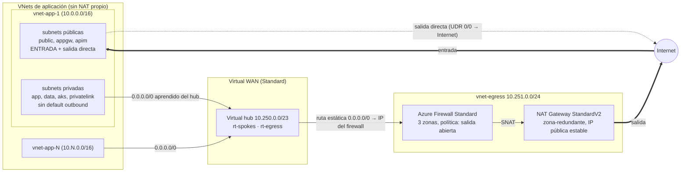

# Diseño: salida centralizada a internet con Virtual WAN

## Requisito

Las VNets de aplicación (estructura de `azure-virtual-network`) no tienen NAT propio: **toda la salida a internet pasa por un punto central de alta disponibilidad** con IPs de salida estables. La **entrada** sigue llegando por las subnets públicas de cada VNet.

## Restricción que condiciona el diseño

El NAT Gateway **no está soportado en el hub de Virtual WAN**, ni en la `AzureFirewallSubnet` de un secured hub (Microsoft lo documenta en *Scale SNAT ports with Azure NAT Gateway*, *Secure your Azure Firewall deployment* y *Troubleshoot NAT gateway*). Un NAT Gateway solo puede asociarse a subnets de una VNet normal conectada al hub.

Por eso la salida vive en una **VNet de egress** conectada al hub:

| Opción | NAT Gateway | Gestión del firewall | Elegida |
|---|---|---|---|
| A. Secured hub (Azure Firewall en el hub + routing intent) | **No** (solo IPs públicas del firewall, hasta 80) | Microsoft, rutas automáticas | No |
| **B. VNet de egress: Azure Firewall + NAT Gateway StandardV2, 0.0.0.0/0 estático en la conexión** | **Sí** | Nosotros (rutas explícitas) | **Sí** |
| C. Hub-and-spoke clásico con peering (sin vWAN) | Sí | Nosotros | No (se pidió vWAN) |

La opción A es más simple de operar pero no cumple "NAT". Si más adelante se prefiere simplicidad sobre IPs estables y 64.512 puertos SNAT por IP, se puede migrar a A.

## Arquitectura

## Enrutamiento (sin routing intent)

Dos tablas de rutas personalizadas en el hub:

| Tabla | La usan (asociadas) | Contiene | Efecto |
|---|---|---|---|
| `rt-spokes` | todos los spokes | `0.0.0.0/0 → firewall` (estática, publicada por la conexión de egress) + prefijo de la VNet de egress | Los spokes salen por el firewall y **no ven a otros spokes** |
| `rt-egress` | la conexión de egress | prefijos de todos los spokes (propagados) | El firewall sabe devolver las respuestas |

Detalles de configuración que Microsoft exige y que ya están en el código:

- La conexión de egress tiene `internet_security_enabled = false` (la conexión que anuncia el 0/0 no debe recibirlo: evita bucles).
- Las conexiones de los spokes tienen `internet_security_enabled = true` (es lo que hace que aprendan el 0/0).
- El 0/0 estático **no se propaga entre hubs**: cada hub/región necesita su propia VNet de egress.
- Los 0/0 en la conexión de egress apuntan a la IP privada del firewall, no a la IP del router del hub.

El firewall además **niega destinos RFC1918** (variable `block_private_destinations`): defensa en profundidad sobre el aislamiento por rutas. Se desactiva cuando haya conectividad híbrida que deba pasar por él.

## Alta disponibilidad

| Componente | Cómo es HA |
|---|---|
| Virtual hub / router | Gestionado por Microsoft |
| Azure Firewall | 3 zonas de disponibilidad |
| NAT Gateway | StandardV2: zona-redundante por diseño (sin `zones`) con IP pública StandardV2 |

No cubre la caída de una región completa (un solo hub). Para DR habría que repetir hub + egress en una segunda región.

## VNet de aplicación `app1`

`app1` (10.1.0.0/16) vive en este repo (`app1_*.tf`) y tiene **las mismas 10 capas** que `azure-virtual-network`: public, appgw, app, data, aks, privatelink, containerapps, aks-virtual-nodes, func y apim, cada una con su NSG (`nsg-app1-snet-*`, salida abierta explícita) y los 7 ASG (`asg-app1-*`). Diferencias:

| | VNet conocida | `app1` |
|---|---|---|
| NAT Gateway propio | Sí | **No**: sale por el hub |
| Salida de las subnets privadas (app, data, aks, privatelink) | NAT Gateway | Ruta 0.0.0.0/0 aprendida del hub (data sigue sin internet: 0/0 → None) |
| Subnets de entrada (public, appgw, apim) | public con 0/0 → Internet; appgw y apim sin route table | Las tres con route table 0/0 → Internet |
| Nombres | `nsg-snet-*`, `rt-*`, `asg-*` | sufijo `app1` (un solo resource group compartido) |

En `snet-app` hay **dos VMs de prueba**, una por zona (`vm-app1-test-z1` y `-z2`, sin IP pública, `Standard_D2as_v4`; los B-series x86 no están disponibles en la suscripción). Las subnets de Azure abarcan todas las zonas ([Reliability in Azure Virtual Network](https://learn.microsoft.com/azure/reliability/reliability-virtual-network)), así que ambas comparten subnet. Si salen a internet, lo hacen solo por app1 → hub → firewall → NAT Gateway.

## Qué NO hace este repo

- Solo hay una VNet de aplicación (`app1`); otras se conectan con `modules/spoke-connection` (ver `spoke-contract.md`). El aislamiento entre spokes no se puede probar con una sola.
- No define DNS privado centralizado (las zonas `privatelink.*` siguen vinculadas por VNet).
- No filtra por FQDN: la salida del firewall está abierta por un supuesto de diseño (no una decisión explícita del propietario; pendiente de decidir). Para filtrar no basta con añadir reglas de aplicación: las reglas de red se evalúan primero y `allow-all-outbound` las dejaría sin efecto (ver `firewall-review.md`).
- No incluye CI ni identidades de CI todavía (ver pendientes en `CLAUDE.md`).

## Costo (precios de lista de Azure Retail Prices, eastus, consultados el 2026-10-19)

| Componente | Precio | Mensual (730 h) |
|---|---|---|
| Azure Firewall Standard | US$1,25/h | ~US$912 |
| Virtual WAN Standard hub | US$0,25/h | ~US$183 |
| NAT Gateway StandardV2 | US$4/mes | US$4 |
| IPs públicas (2) y Log Analytics | pocos centavos/h | ~US$10-15 (sin verificar) |
| VM de prueba D2as_v4 | ~US$0,1/h (sin verificar) | ~US$70 |
| **Total sin tráfico** | **~US$1,6/h (~US$38/día)** | **~US$1.170** |

Además se cobra por GB procesado: hub US$0,02/GB; el firewall y el NAT también cobran por GB (el del firewall no se consultó). El firewall es el 80 % del costo. El hub tarda 20-30 min en crearse. Es una POC para levantar, probar y dar de baja el mismo día: unas 3 horas de prueba cuestan ~US$5.
