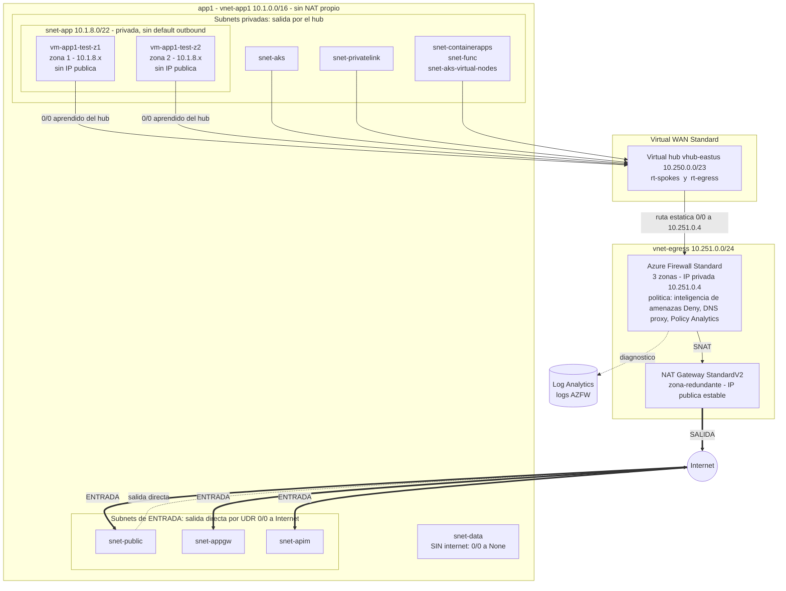
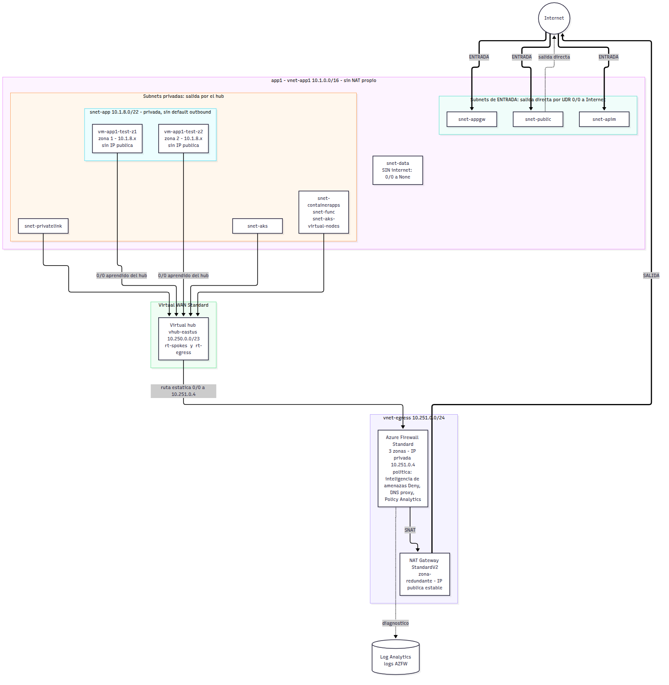
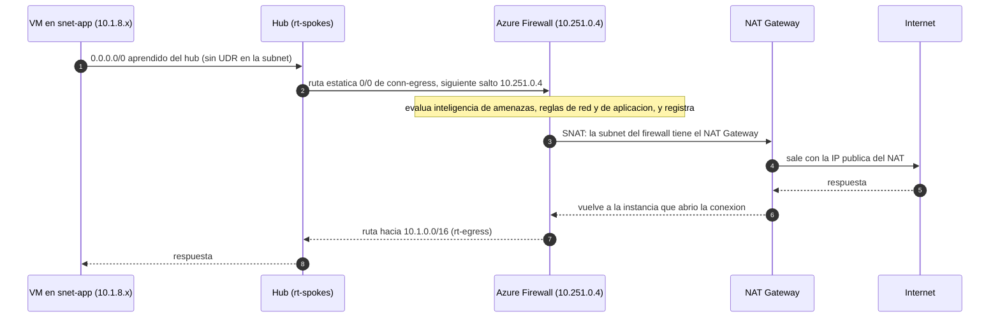
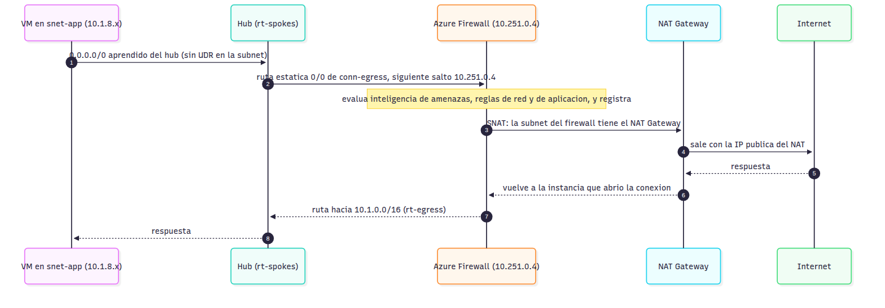
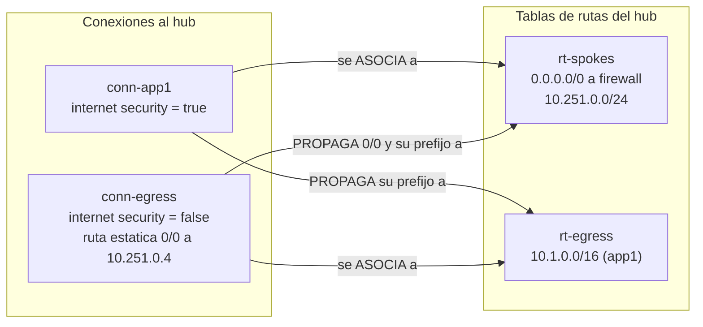
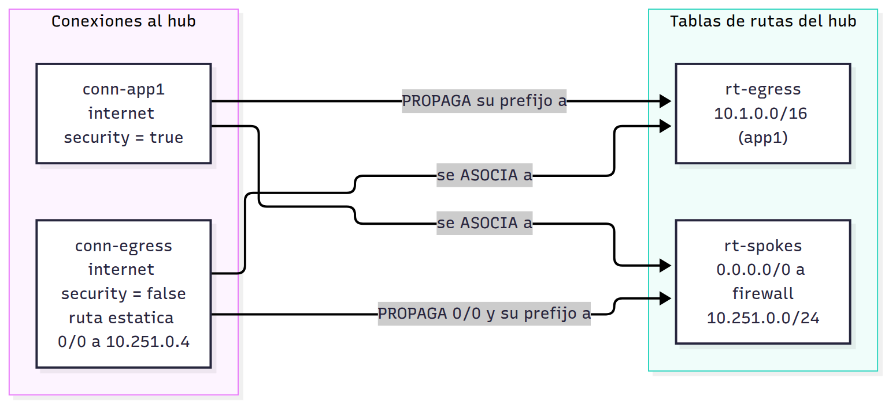
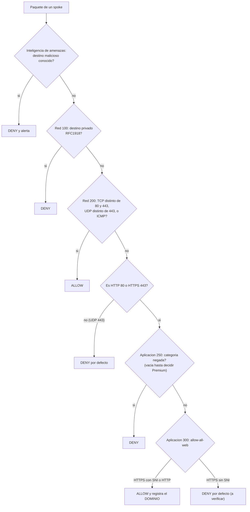
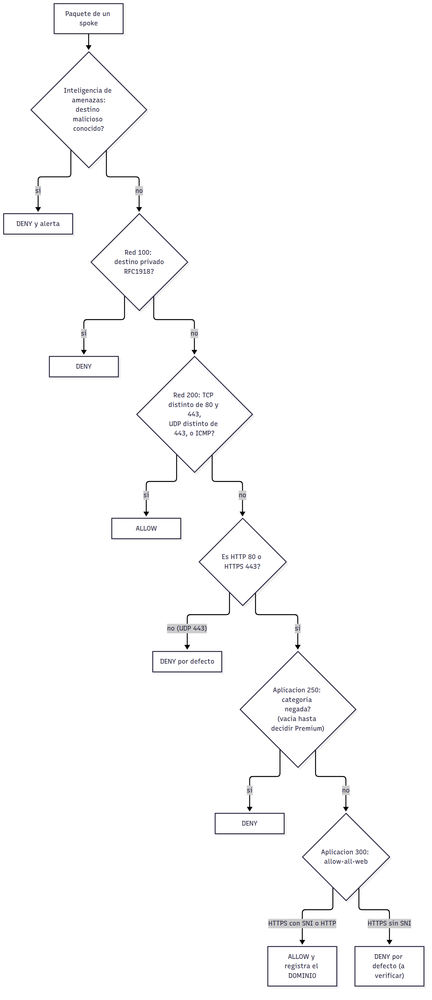
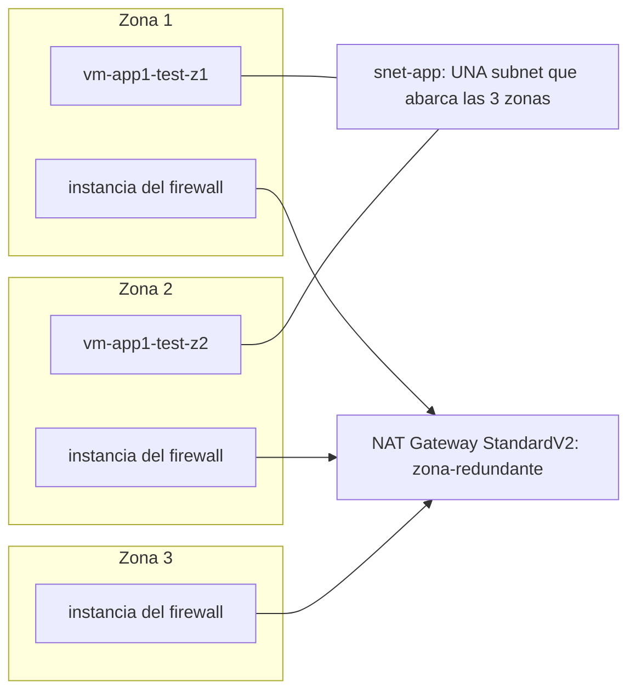
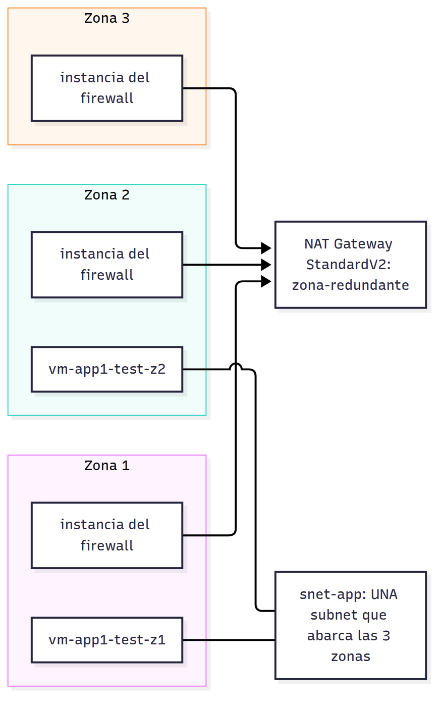

# Diagramas de la solución

Los diagramas se dibujan solos en GitHub (Mermaid); cada uno tiene también una imagen en [`img/`](img/) por si se ven desde un editor sin soporte de Mermaid. Reflejan lo que se desplegó y probó el 2026-10-19, más las reglas de dominio añadidas el 2026-10-21 (aún sin desplegar). Los CIDR son los del repo.

## 1. Arquitectura general

Ver como imagen

## 2. Camino de un paquete de salida

Ver como imagen

## 3. Enrutamiento de Virtual WAN

Ver como imagen

Los spokes solo tienen en `rt-spokes` la ruta al firewall: no ven a otros spokes (aislamiento). El firewall ve el prefijo de cada spoke en `rt-egress`, que es lo que le permite devolver las respuestas.

## 4. Cómo evalúa el firewall un paquete

Ver como imagen

Las reglas de red se evalúan antes que las de aplicación y son terminantes; por eso la regla de red 200 excluye el tráfico web.

## 5. Zonas de disponibilidad

Ver como imagen

Las subnets de Azure no pertenecen a una zona; solo los recursos que se colocan en ellas (VM, firewall) son zonales o zona-redundantes.
